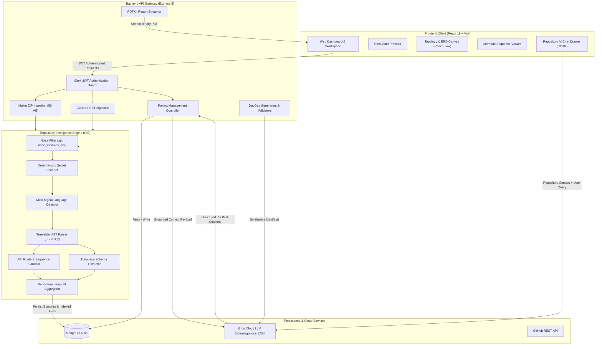
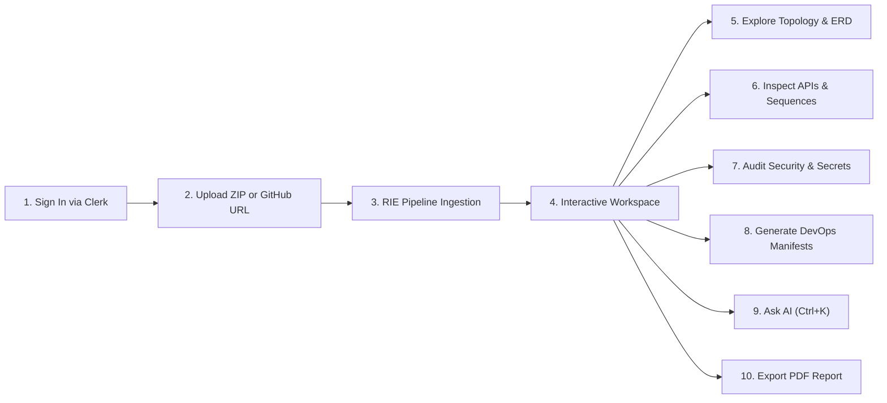

<div align="center">

# ArchMind AI

### **AI-Powered Repository Intelligence Platform**

Transform any software repository into interactive system topologies, database ER diagrams, API sequence flows, AST security audits, and deployable DevOps manifests — in seconds.

[](#technology-stack)
[](#technology-stack)
[](#prerequisites)
[](#technology-stack)
[-F55036)](#technology-stack)
[](#security-and-safe-development)
[](#license)

<br/>

[**Explore Features**](#key-features) • [**Quickstart Guide**](#quickstart-in-3-steps) • [**Architecture**](#architecture-overview) • [**API Reference**](#api-documentation) • [**Testing Suite**](#automated-testing)

</div>

---

## Table of Contents

- [Overview](#overview)
- [Why ArchMind AI?](#why-archmind-ai)
- [Key Features](#key-features)
- [Workspace Preview](#workspace-preview)
- [Technology Stack](#technology-stack)
- [Architecture Overview](#architecture-overview)
- [Prerequisites](#prerequisites)
- [Quickstart in 3 Steps](#quickstart-in-3-steps)
- [Environment Variables](#environment-variables)
- [User Walkthrough](#user-walkthrough)
- [API Documentation](#api-documentation)
- [Automated Testing](#automated-testing)
- [Repository Structure](#repository-structure)
- [Troubleshooting](#troubleshooting)
- [Security and Safe Development](#security-and-safe-development)
- [Contributing](#contributing)
- [License](#license)
- [Acknowledgements](#acknowledgements)

---

## Overview

**ArchMind AI** eliminates manual codebase onboarding by converting imported repositories into an intelligent, interactive workspace. Instead of navigating thousands of lines of unfamiliar code across nested directories, developers and engineering teams ingest any repository via **ZIP archive upload** or **GitHub URL**.

The platform combines deterministic static analysis with high-speed LLM inference:
1. **Sanitizes & Normalizes**: Automatically excludes dependency noise (`node_modules`, `.git`, `dist`, `venv`).
2. **Parses ASTs**: Extracts imports, exports, functions, routes, and models via **Tree-sitter** (JavaScript, TypeScript, Python).
3. **Compiles a Blueprint**: Assembles a versioned, token-budgeted Repository Blueprint with cryptographic source fingerprinting.
4. **Synthesizes & Visualizes**: Generates interactive React Flow topology graphs, database ERDs, API sequence flows, and validated DevOps manifests using **Groq Cloud**.
5. **Generates Reports**: Streams production-ready, multi-page PDF engineering dossiers built with **PDFKit**.

---

## Why ArchMind AI?

| The Traditional Way | The ArchMind AI Way |
|---|---|
| ⏳ **Hours spent reading directories**: Exploring folders to figure out how services connect. | ⚡ **Instant System Topology**: Auto-generated React Flow graph displaying Frontend, Backend, DB, and DevOps tiers. |
| 🪓 **Broken, hallucinated AI answers**: Generic LLMs make up file paths and outdated dependencies. | 🎯 **Grounded with Line Citations**: Repository chat cites exact file paths and line ranges (`L12–L34`). |
| 🔍 **Hidden vulnerabilities & leaked keys**: Committing secrets or insecure `eval()` calls by accident. | 🛡️ **Zero-Leak Security Audits**: High-entropy secret redaction and Tree-sitter AST vulnerability scanning. |
| 📝 **Writing Docker & K8s boilerplate from scratch**: Guessing versions and misconfiguring ports. | ⚙️ **Validated DevOps Manifests**: Pre-validated multi-stage Dockerfiles, GitHub Actions, and K8s manifests. |

---

## Key Features

### 1. Dual Ingestion & Noise Filtering
- **Drag-and-Drop ZIP Upload**: Supports archives up to 50 MB with disk isolation and Zip Slip protection.
- **GitHub URL Import**: Fetches repository trees via GitHub REST API with rate-limit handling.
- **Smart Noise Filtering**: Automatically ignores lockfiles, test fixtures, compiled bundles, and binaries.
- **Cryptographic Fingerprinting**: Tracks `sourceFingerprint` and `analysisVersion` to invalidate cache accurately.

### 2. Interactive Visualizations
- **System Topology Canvas**: Interactive React Flow canvas with Dagre layout management (Left-to-Right and Top-to-Bottom orientations).
- **Database ER Diagram Visualizer**: Zoomable ERD canvas showing entities, columns, primary keys, and relationships (Mongoose, Prisma, SQL, Django).
- **Capability Matrix Engine**: Automatically activates module tabs (`hasDatabase`, `hasApis`, `hasDevops`, `hasSecuritySensitiveCode`) without false server errors.

### 3. API Route Explorer & Sequence Flows
- **Static Route Extraction**: Discovers endpoints across Express, Fastify, NestJS, FastAPI, Flask, and Django.
- **Multi-Field Filtering**: Filter routes by HTTP verb (`GET`, `POST`, `PUT`, `DELETE`), framework, or auth status.
- **Mermaid Request Sequences**: Generates sandboxed sequence diagrams tracing `Client → Middleware → Controller → Service → Database → Response`.
- **Line-Level Citations**: Direct links from route cards to exact source code line numbers.

### 4. Zero-Leak Security Audit
- **Deterministic Secret Scanner**: Scans for AWS keys, GitHub tokens, Stripe secrets, and passwords with automatic masking.
- **AST Vulnerability Scanner**: Tree-sitter detection of code injection, unsafe deserialization, path traversal, and dangerous `exec` calls.
- **AI-Assisted Code Reviews**: Categorized review recommendations (Architecture, Performance, Maintainability).
- **Automated Test Generation**: Generates unit and API test boilerplate (Jest / Pytest) without modifying project files.

### 5. Automated DevOps & CI/CD Synthesis
- **Multi-Stage Dockerfiles**: Generated with non-root security standards and aligned runtime versions.
- **GitHub Actions Workflows**: Automatically mapped to existing `package.json` test/build scripts.
- **Kubernetes Manifests**: Aligned `Deployment`, `Service`, and `ConfigMap` resources with health check probes.
- **Pre-Flight Syntax Validation**: In-engine validator checks for label mismatches, missing ports, and raw secrets.

### 6. Context-Grounded Repository AI Chat
- **Blueprint-Aware QA**: Queries answered with full context of repository dependencies, routes, and schemas.
- **Verified Citations**: All answers cite real source files and line ranges.
- **Global Shortcut**: Press <kbd>Ctrl</kbd> + <kbd>K</kbd> (or <kbd>Ctrl</kbd> + <kbd>/</kbd>) from anywhere in the workspace.
- **Persistent History**: Multi-turn conversations saved in MongoDB with custom titling.

### 7. Engineering PDF Report Generator
- **Server-Side Streaming**: Direct streaming via `pdfkit` without writing temporary files to disk.
- **Comprehensive Dossier**: Executive summary, repository stats, tech stack, API route catalog, security audit findings, and DevOps inventory.
- **Redacted Output**: Guarantees zero sensitive tokens or internal paths leak into exported documents.

---

## Workspace Preview

```
+-----------------------------------------------------------------------------------------------+
|  ArchMind AI — Repository Intelligence Workspace                                [Export PDF]  |
+-----------------------------------------------------------------------------------------------+
| [❖ Topology] [⬡ ER Diagram] [⇄ API Explorer] [⚙ DevOps & CI/CD] [🛡 Security Audit]          |
+-----------------------------------------------------------------------------------------------+
| 📁 Repository Files            |  ❖ Interactive System Topology Canvas                        |
|   ├── controllers/             |                                                              |
|   │   ├── project.controller.js|       +-----------------+         +---------------------+    |
|   │   └── chat.controller.js   |       |  React Client   | ------> | Express API Gateway |    |
|   ├── models/                  |       +-----------------+         +---------------------+    |
|   │   ├── Project.js           |                                              |               |
|   │   └── User.js              |                                              v               |
|   └── routes/                  |                                    +-------------------+     |
|       └── project.routes.js    |                                    |   MongoDB Atlas   |     |
|                                |                                    +-------------------+     |
| 📊 Stats: 54 Files (1.2 MB)    |                                                              |
| ⚡ Primary: JavaScript (94%)   |  [Orient: LR / TB]  [Fit View]  [Controls]  [Minimap]        |
+-----------------------------------------------------------------------------------------------+
| 💬 Repository AI Assistant (Ctrl+K): "How does authentication middleware guard project routes?"|
| > Clerk JWT verification is enforced via requireAuth middleware in server/src/app.js#L43       |
+-----------------------------------------------------------------------------------------------+
```

---

## Technology Stack

<div align="center">

| Tier | Technologies |
|---|---|
| **Frontend UI** | **React 19**, **Vite 8**, **Tailwind CSS v4**, **Framer Motion**, **Lenis** |
| **Interactive Canvas** | **@xyflow/react (React Flow)**, **Dagre** layout engine, **Mermaid.js** |
| **Backend API** | **Node.js** (ES Modules), **Express.js 5**, **Multer 2**, **Adm-Zip** |
| **Static Code Parsing** | **Tree-sitter** (`tree-sitter-javascript`, `tree-sitter-typescript`, `tree-sitter-python`) |
| **Database & ODM** | **MongoDB Atlas**, **Mongoose 9** |
| **Authentication** | **Clerk** (`@clerk/clerk-react`, `@clerk/express` JWT verification) |
| **LLM Inference** | **Groq Cloud SDK** (`groq-sdk`, model: `openai/gpt-oss-120b`) |
| **Report Generation** | **PDFKit** (Node.js native streaming document builder) |

</div>

---

## Architecture Overview

The platform cleanly separates **deterministic static analysis** (Tree-sitter, regex scanning, manifest extraction) from **probabilistic AI features** (Groq LLM).



---

## Prerequisites

- **Node.js**: `v18.0.0` or higher (tested on Node.js v20 and v24 with native ES Modules).
- **MongoDB**: MongoDB Atlas database connection string or a local MongoDB instance.
- **Clerk Account**: Free API keys from [clerk.com](https://clerk.com/).
- **Groq API Key**: Free API key from [console.groq.com](https://console.groq.com/).

---

## Quickstart in 3 Steps

### Step 1: Clone Repository
```bash
git clone https://github.com/Subham-0725/ArchMind-AI.git
cd ArchMind-AI
```

### Step 2: Configure & Start Backend Server
```bash
cd server
cp .env.example .env
npm install
npm run dev
```
*Backend runs on `http://localhost:5000`.*

### Step 3: Configure & Start Frontend Client
Open a second terminal:
```bash
cd client
npm install
npm run dev
```
*Frontend runs on `http://localhost:5173`.*

---

## Environment Variables

<details open>
<summary><b>Server Configuration (<code>server/.env</code>)</b></summary>
<br/>

| Variable | Required | Default | Description |
|---|:---:|---|---|
| `PORT` | No | `5000` | HTTP port for the Express backend. |
| `MONGODB_URI` | **Yes** | — | MongoDB Atlas connection string (`mongodb+srv://...`). |
| `CLERK_PUBLISHABLE_KEY` | **Yes** | — | Clerk publishable key from your Clerk Dashboard. |
| `CLERK_SECRET_KEY` | **Yes** | — | Clerk secret key for validating JWTs in middleware. |
| `GROQ_API_KEY` | **Yes** | — | Groq Cloud API key for LLM completions. |
| `GROQ_MODEL` | No | `openai/gpt-oss-120b` | Groq model identifier for completions. |
| `CLIENT_URL` | No | `http://localhost:5173` | Allowed frontend origin for CORS. |
| `HOST` | No | Dual-stack (`::`) | Network interface to bind. |

</details>

<details open>
<summary><b>Client Configuration (<code>client/.env</code>)</b></summary>
<br/>

| Variable | Required | Default | Description |
|---|:---:|---|---|
| `VITE_CLERK_PUBLISHABLE_KEY` | **Yes** | — | Clerk Frontend Publishable Key for authentication. |
| `VITE_API_BASE_URL` | No | `http://localhost:5000` | Base endpoint URL of the backend API. |

</details>

---

## User Walkthrough



1. **Sign In**: Access the landing page and authenticate securely with Clerk.
2. **Ingest Repository**: Drag and drop a project `.zip` file (up to 50 MB) or enter a GitHub repository link.
3. **Automated Pipeline**: The Repository Intelligence Engine filters noise, scans secrets, identifies frameworks, parses AST trees, and indexes source files.
4. **Interactive Exploration**:
   - **Topology Canvas**: Zoom, pan, and switch layout orientations (LR/TB).
   - **ER Diagram**: Inspect entity columns, types, and foreign key relations.
   - **API Explorer**: Filter REST endpoints and generate Mermaid sequence diagrams.
   - **DevOps Center**: Generate and validate multi-stage Dockerfiles, GitHub Actions, and K8s manifests.
   - **Security Audit**: Inspect masked secrets and AST vulnerabilities with line citations.
5. **Chat with Codebase**: Open the AI drawer with <kbd>Ctrl</kbd> + <kbd>K</kbd> to ask technical questions with exact source citations.
6. **Export Dossier**: Click **Export PDF** in the header to download a complete engineering report.

---

## API Documentation

All protected endpoints require an `Authorization: Bearer <clerk_jwt>` header.

<details>
<summary><b>🔍 Click to expand complete API Endpoints Table</b></summary>
<br/>

### System & Users
| Method | Endpoint | Description | Auth |
|---|---|---|:---:|
| `GET` | `/api/health` | Health check endpoint | Public |
| `POST` | `/api/users/sync` | Sync Clerk user profile to MongoDB | Required |
| `GET` | `/api/users/me` | Fetch authenticated user profile | Required |

### Project Management & Ingestion
| Method | Endpoint | Description | Auth |
|---|---|---|:---:|
| `POST` | `/api/projects/upload` | Upload `.zip` repository archive (Multer 50 MB limit) | Required |
| `POST` | `/api/projects/github` | Import repository via GitHub REST API | Required |
| `GET` | `/api/projects` | List user projects with pagination (`page`, `limit`) & search (`q`) | Required |
| `GET` | `/api/projects/:id` | Get full project details with file tree | Required |
| `PATCH` | `/api/projects/:id` | Update project metadata (`name`, `description`) | Required |
| `DELETE` | `/api/projects/:id` | Cascade delete project and child collections | Required |
| `PATCH` | `/api/projects/:id/status` | Update processing status (`uploaded`, `processing`, `completed`) | Required |
| `GET` | `/api/projects/:id/blueprint` | Fetch compiled Repository Blueprint JSON | Required |
| `GET` | `/api/projects/:id/file?path=...` | Retrieve indexed source file with secret masking | Required |

### Analysis & Reports
| Method | Endpoint | Description | Auth |
|---|---|---|:---:|
| `POST` | `/api/projects/:id/analyze` | Queue and trigger full multi-module analysis | Required |
| `POST` | `/api/projects/:id/reanalyze` | Increment `analysisVersion`, clear cache, and re-run RIE | Required |
| `GET` | `/api/projects/:id/analysis` | Fetch status of each individual analysis module | Required |
| `POST` | `/api/projects/:id/:module` | Trigger single module (`architecture`, `erd`, `api`, `security`, `devops`) | Required |
| `GET` | `/api/projects/:id/report/pdf` | Stream generated engineering PDF report via PDFKit | Required |

### API Route Intelligence
| Method | Endpoint | Description | Auth |
|---|---|---|:---:|
| `GET` | `/api/projects/:id/api-routes` | List extracted routes with query filters (`method`, `search`, `auth`) | Required |
| `GET` | `/api/projects/:id/api-routes/:routeId` | Get detailed route information with line-level source citation | Required |
| `GET` | `/api/projects/:id/api-routes/:routeId/sequence` | Generate Mermaid sequence diagram for route | Required |

### Security & Code Quality
| Method | Endpoint | Description | Auth |
|---|---|---|:---:|
| `POST` | `/api/projects/:projectId/security/scan` | Trigger deterministic secret & AST vulnerability scan | Required |
| `GET` | `/api/projects/:projectId/security` | Get security metrics and finding counts | Required |
| `GET` | `/api/projects/:projectId/security/findings` | List security findings with severity filters | Required |
| `PATCH` | `/api/projects/:projectId/security/findings/:findingId` | Update finding status (`open`, `resolved`, `false_positive`) | Required |
| `POST` | `/api/projects/:projectId/code-review` | Trigger AI-assisted code review via Groq | Required |
| `POST` | `/api/projects/:projectId/tests/generate` | Generate Jest / Pytest test preview via Groq | Required |

### Repository AI Chat
| Method | Endpoint | Description | Auth |
|---|---|---|:---:|
| `POST` | `/api/projects/:projectId/chat/conversations` | Create a new conversation session | Required |
| `GET` | `/api/projects/:projectId/chat/conversations` | List conversation sessions for project | Required |
| `GET` | `/api/projects/:projectId/chat/conversations/:conversationId` | Get conversation history & messages | Required |
| `POST` | `/api/projects/:projectId/chat/conversations/:conversationId/messages` | Send prompt & receive Groq answer with citations | Required |
| `PATCH` | `/api/projects/:projectId/chat/conversations/:conversationId` | Update conversation title or pinned status | Required |
| `DELETE` | `/api/projects/:projectId/chat/conversations/:conversationId` | Delete conversation session | Required |

### DevOps Artifacts
| Method | Endpoint | Description | Auth |
|---|---|---|:---:|
| `POST` | `/api/projects/:projectId/devops/generate` | Synthesize Dockerfile, CI/CD, and K8s manifests | Required |
| `GET` | `/api/projects/:projectId/devops/artifacts` | List generated DevOps manifests | Required |
| `GET` | `/api/projects/:projectId/devops/artifacts/:artifactId` | Retrieve specific manifest content | Required |
| `POST` | `/api/projects/:projectId/devops/artifacts/:artifactId/regenerate` | Regenerate and supersede artifact | Required |
| `POST` | `/api/projects/:projectId/devops/artifacts/:artifactId/validate` | Run deterministic syntax & policy validator | Required |
| `DELETE` | `/api/projects/:projectId/devops/artifacts/:artifactId` | Remove DevOps artifact | Required |

</details>

---

## Automated Testing

ArchMind AI includes comprehensive test suites written using Node.js ES Modules with **zero third-party test framework overhead**.

```bash
# 🎯 Phase 6 Workspace & PDF Report Suite (20 Assertions)
node server/test-phase6-suite.js

# ⚙️ DevOps Artifact Generation & Validation Suite (29 Assertions)
node server/test-devops-suite.js

# 🛡️ Security Audit, Secret Scanner & Test Generator Suite (10 Assertions)
node server/test-security-suite.js

# 💬 Repository AI Chat & Citation Verification Suite (10 Assertions)
node server/test-chat-service.js

# ⇄ API Route Extractor & Sequence Generator Suite (6 Assertions)
node server/test-api-routes-api.js

# 📦 ZIP Ingestion Pipeline & Multer Isolation Suite (8 Assertions)
node server/test-zip-upload-pipeline.js

# 🖥️ Frontend Phase 6 Workspace Verification Suite (14 Assertions)
node client/test-phase6-frontend.js

# 🔍 Run Frontend ESLint
npm --prefix client run lint
```

---

## Repository Structure

```
ArchMind AI/
├── client/                     # Frontend Application (React 19, Vite 8, Tailwind v4)
│   ├── src/
│   │   ├── components/project/ # Workspace modules (topology, erd, apis, devops, security, chat)
│   │   ├── pages/              # LandingPage, Dashboard, ProjectWorkspace
│   │   ├── services/           # Axios API services (projectService, userService)
│   │   └── constants/          # Workspace tabs and capability configuration
│   └── package.json
│
├── server/                     # Backend Application (Node.js, Express 5, Mongoose 9)
│   ├── src/
│   │   ├── controllers/        # Project, Analysis, Chat, Security, Report controllers
│   │   ├── devops/             # Dockerfile, CI/CD, and K8s generators & validators
│   │   ├── models/             # User, Project, SourceFile, Conversation, SecurityFinding, DevOpsArtifact
│   │   ├── rie/                # Repository Intelligence Engine (AST, Routes, Schemas, Blueprint)
│   │   └── services/           # Groq Chat, PDFKit Streaming, Language Detector
│   ├── storage/                # Ephemeral ZIP upload staging (ignored by nodemon)
│   └── package.json
│
├── context/                    # Architecture guidelines, specifications & progress tracker
└── README.md                   # You are here!
```

---

## Troubleshooting

<details>
<summary><b>1. Backend fails with <code>GROQ_KEY_MISSING</code> (503 Service Unavailable)</b></summary>
<br/>

- **Cause**: `GROQ_API_KEY` is missing or contains placeholder text in `server/.env`.
- **Solution**: Obtain a free API key from [Groq Console](https://console.groq.com/) and paste it into `server/.env`. Verify `GROQ_MODEL=openai/gpt-oss-120b`.
</details>

<details>
<summary><b>2. MongoDB Connection Timeout</b></summary>
<br/>

- **Cause**: IP address not whitelisted in MongoDB Atlas Network Access.
- **Solution**: Navigate to your MongoDB Atlas dashboard -> **Network Access** -> **Add IP Address** -> Select **Allow Access from Anywhere** (`0.0.0.0/0`) for local development.
</details>

<details>
<summary><b>3. Client shows <code>Missing Publishable Key in .env file</code></b></summary>
<br/>

- **Cause**: `client/.env` is missing `VITE_CLERK_PUBLISHABLE_KEY`.
- **Solution**: Create `client/.env` and supply your `pk_test_...` key from Clerk. Restart the Vite development server.
</details>

<details>
<summary><b>4. Nodemon restarts mid-upload during ZIP extraction</b></summary>
<br/>

- **Cause**: Ephemeral files trigger Nodemon file watchers.
- **Solution**: Extraction takes place in `server/storage/`, which is ignored in `server/nodemon.json`. If using custom directories, ensure extraction paths are excluded from watch rules.
</details>

<details>
<summary><b>5. PDF download returns <code>ANALYSIS_INCOMPLETE</code> (400)</b></summary>
<br/>

- **Cause**: Requesting a PDF report while repository analysis is still processing.
- **Solution**: Wait until project status pill in the workspace header displays **Completed** before exporting.
</details>

---

## Security and Safe Development

- **No Secrets in Version Control**: `.env` and `.env.local` are explicitly ignored by `.gitignore`.
- **Automatic Secret Redaction**: The secret scanner masks API keys, passwords, and tokens before they reach the database or LLM prompts.
- **Multi-Tenant Ownership Isolation**: Every project route enforces `project.userId === req.auth.userId`. Unrelated users receive `403 Forbidden`.
- **Safe Static Analysis**: Tree-sitter parsers inspect AST structures statically without executing code.
- **Zip Slip Defense**: Archive extraction normalizes paths and rejects directory traversal sequences (`../`).

---

## Contributing

Contributions are welcome! Please follow these steps:

1. **Fork** the repository.
2. **Create a branch**: `git checkout -b feature/amazing-feature`.
3. **Commit your changes**: `git commit -m "feat: add support for new framework"`.
4. **Run tests**:
   ```bash
   node server/test-phase6-suite.js
   npm --prefix client run lint
   ```
5. **Push to branch**: `git push origin feature/amazing-feature`.
6. **Open a Pull Request** against the `Subham` branch.

---

## License

No dedicated `LICENSE` file was found at the repository root. `server/package.json` specifies `"license": "ISC"`.

---

## Acknowledgements

- [Tree-sitter](https://tree-sitter.github.io/tree-sitter/) — Fast, robust multi-language AST parsing.
- [React Flow (@xyflow/react)](https://reactflow.dev/) — Interactive node-based diagramming.
- [Groq](https://groq.com/) — High-speed LLM inference engine.
- [Clerk](https://clerk.com/) — Complete user authentication and session management.
- [PDFKit](https://pdfkit.org/) — Server-side streaming PDF generation.
- [Tailwind CSS](https://tailwindcss.com/) — Modern utility-first styling.
