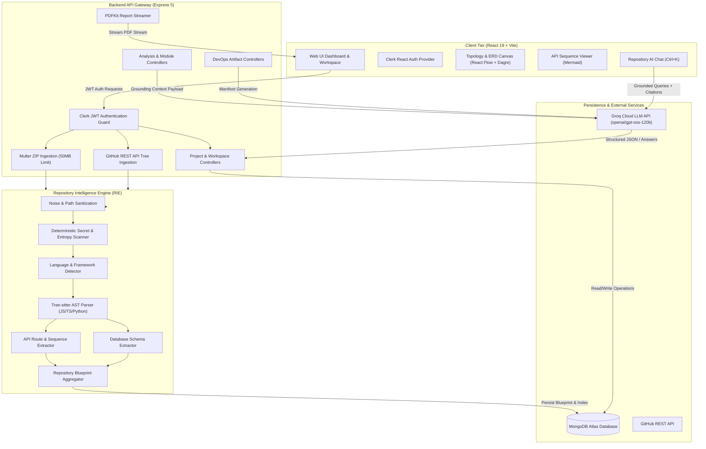

# ArchMind AI

A full-stack repository intelligence platform that analyzes software codebases and produces structured technical insights, interactive system topologies, database ER diagrams, API sequence flows, AST security audits, DevOps infrastructure manifests, and downloadable engineering PDF reports.

[](#technology-stack)
[](#prerequisites)
[](#technology-stack)
[](#technology-stack)
[](#technology-stack)
[](#technology-stack)
[](#authentication)

---

## Table of Contents

- [Overview](#overview)
- [Key Features](#key-features)
- [Screenshots and Demo](#screenshots-and-demo)
- [Technology Stack](#technology-stack)
- [Architecture Overview](#architecture-overview)
- [Repository Structure](#repository-structure)
- [Prerequisites](#prerequisites)
- [Installation and Setup](#installation-and-setup)
- [Environment Variables](#environment-variables)
- [Running the Application](#running-the-application)
- [User Workflow](#user-workflow)
- [API Documentation](#api-documentation)
- [Automated Testing](#automated-testing)
- [Troubleshooting](#troubleshooting)
- [Security and Safe Development](#security-and-safe-development)
- [Contributing](#contributing)
- [License](#license)
- [Acknowledgements](#acknowledgements)

---

## Overview

**ArchMind AI** eliminates manual codebase onboarding by converting imported repositories into an intelligent, interactive workspace. Instead of inspecting large directory trees file-by-file, developers, software architects, and engineering teams can ingest any codebase via **ZIP archive upload** or **GitHub URL import**.

The platform's **Repository Intelligence Engine (RIE)** processes the repository through a multi-stage static analysis pipeline:
1. Strips build artifacts and dependency noise (`node_modules`, `.git`, `dist`, `venv`).
2. Scans for exposed credentials and secrets with zero raw secret persistence.
3. Automatically detects languages, package manifests, and frameworks with weighted confidence scoring.
4. Parses Abstract Syntax Trees (AST) using **Tree-sitter** for JavaScript, TypeScript, and Python.
5. Extracts API routes, parameter signatures, and database schemas (Mongoose, Prisma, SQL, Django).
6. Compiles a versioned, token-budgeted **Repository Blueprint**.
7. Orchestrates **Groq LLM** inference for topology refinement, ER diagrams, context-grounded AI chat with line-level source citations, code reviews, test generation, and DevOps synthesis.
8. Streams downloadable, production-grade **PDF engineering reports** generated server-side with **PDFKit**.

---

## Key Features

### Repository Ingestion & Noise Filtering
- **Dual Ingestion Paths**: Upload compressed `.zip` archives (up to 50 MB with disk isolation and Zip Slip protection) or import public/private repositories via GitHub REST API.
- **Automated Noise Exclusion**: Ignores lockfiles, test fixtures, build outputs, virtual environments, and binary assets to keep analysis payloads lean.
- **Source Fingerprinting & Invalidation**: Cryptographic SHA hashing detects codebase changes, tracks analysis versions (`analysisVersion`), and prevents stale cache re-use.

### Static Code Analysis & AST Parsing
- **Tree-sitter Parsing Engine**: Multi-language AST parsing across JavaScript, TypeScript, and Python.
- **Schema & Model Extraction**: Automatic detection and structure extraction for Mongoose schemas, Prisma schemas, SQL DDL definitions, and Django/SQLAlchemy models.
- **Multi-Signal Language Detection**: Evaluates manifest files (`package.json`, `requirements.txt`, `go.mod`, `Cargo.toml`, etc.), file extensions, and byte-size ratios to identify primary and secondary languages.

### Interactive System Visualizations
- **System Topology Canvas**: Interactive React Flow diagram displaying service tiers (Frontend, Backend, Database, DevOps) with Dagre layout management (Left-to-Right and Top-to-Bottom orientations).
- **Database ER Diagram Visualizer**: Dedicated zoomable canvas mapping database entities, fields, data types, primary keys, and cross-entity relationships.
- **Capability Matrix Detection**: Dynamically toggles workspace tabs based on detected project capabilities (`hasDatabase`, `hasApis`, `hasDevops`, `hasSecuritySensitiveCode`).

### API Route Intelligence & Sequence Diagrams
- **Static Route Discovery**: Scans controllers and route declarations across Express, Fastify, NestJS, FastAPI, Flask, and Django.
- **Route Filtering**: Filter endpoints by HTTP verb (`GET`, `POST`, `PUT`, `PATCH`, `DELETE`), framework, authentication requirement, or path keyword.
- **Sequence Diagram Synthesis**: Sandboxed Mermaid sequence diagram generator modeling request lifecycle flows (`Client -> Router -> Middleware -> Controller -> Service -> Database -> Response`) with strict depth bounds.
- **Line-Level Citations**: Direct mapping from extracted route records to specific source code line numbers.

### Security Audits & Code Quality
- **Deterministic Secret Scanner**: High-entropy regex pattern matching for AWS keys, GitHub tokens, Stripe secrets, private keys, and passwords with automatic redaction.
- **AST Vulnerability Scanner**: Detects dangerous function calls (`eval`, unsafe `exec`, path traversal, prototype pollution, unsafe deserialization) with exact line citations.
- **AI-Assisted Code Reviews**: Groq-powered review generating categorized findings (Architecture, Performance, Maintainability, Security) with remediation advice.
- **Automated Test Generation**: Generates Jest or Pytest test suite boilerplate without modifying project files.

### DevOps & Infrastructure Synthesis
- **Automated Dockerfile Generation**: Produces multi-stage Dockerfiles tailored to detected package managers and runtimes with non-root security defaults.
- **CI/CD Workflow Synthesis**: Generates GitHub Actions workflow manifests (`.github/workflows/ci.yml`) matching repository test and build scripts.
- **Kubernetes Manifest Synthesis**: Produces Kubernetes `Deployment`, `Service`, and `ConfigMap` resources with health check probes and label alignment.
- **Deterministic Syntax & Policy Validation**: In-engine validator checks generated manifests for missing required fields, label mismatches, and embedded secrets before saving.

### Grounded Repository AI Chat
- **Context-Aware Retrieval**: Answers technical questions about the codebase using the compiled Repository Blueprint and indexed source files.
- **Line-Level Source Citations**: AI responses cite exact file paths and line ranges (`path/to/file.js#L12-L34`).
- **Persistent Conversation History**: Multi-turn chat sessions scoped per user and project, stored in MongoDB Atlas with title generation and conversation management.

### Engineering PDF Report Generation
- **Server-Side Streaming**: Generates multi-page engineering PDF reports using `pdfkit` without writing intermediate files to disk.
- **Dossier Coverage**: Includes Executive Summary, Repository Metrics, Technology Stack Breakdown, Capability Matrix, API Route Catalog, Security Audit Findings, and DevOps Manifest Inventory.
- **Automatic Secret Redaction**: Sanitizes all file paths and credentials before embedding into the PDF document.

---

## Screenshots and Demo

> *Note: UI screenshots and animated walkthroughs will be added in upcoming releases. To explore the interface locally, follow the [Installation and Setup](#installation-and-setup) instructions below.*

```
+---------------------------------------------------------------------------------------+
|  ArchMind AI — Interactive Repository Intelligence Workspace                          |
+---------------------------------------------------------------------------------------+
| [Overview]  [Tech Stack]  [Analysis Status]  |  [Topology] [ERD] [APIs] [DevOps] [Security] |
|                                              |                                        |
| 📁 src/                                      |   +---------------+     +------------+ |
|   ├── controllers/                           |   | React Client  | --> | Express API | |
|   ├── models/                                |   +---------------+     +------------+ |
|   └── routes/                                |                               |        |
|                                              |                               v        |
| 📊 Metrics: 42 files, 8 APIs, 3 Models       |                       +--------------+ |
| 🛡 Security: 0 Leaks, 2 Warnings             |                       | MongoDB Atlas| |
| ⚙ DevOps: Dockerfile, K8s, CI/CD Validated   |                       +--------------+ |
+---------------------------------------------------------------------------------------+
| [Ask AI / Ctrl+K] [Export PDF Report]                                                 |
+---------------------------------------------------------------------------------------+
```

---

## Technology Stack

### Frontend
- **Framework**: [React 19](https://react.dev/) with [Vite 8](https://vitejs.dev/)
- **Routing**: [React Router DOM v7](https://reactrouter.com/)
- **Styling**: [Tailwind CSS v4](https://tailwindcss.com/)
- **Graph & Diagramming**: [@xyflow/react (React Flow)](https://reactflow.dev/) and [Dagre](https://github.com/dagrejs/dagre)
- **Diagram Rendering**: [Mermaid](https://mermaid.js.org/) (strict client-side rendering)
- **Animation & Scrolling**: [Framer Motion](https://www.framer.com/motion/) and [Lenis](https://lenis.darkroom.engineering/)
- **HTTP Client**: [Axios](https://axios-http.com/)

### Backend
- **Runtime**: [Node.js](https://nodejs.org/) (v18+ / v20+ / v24) with native ES Modules (`"type": "module"`)
- **Server Framework**: [Express.js 5](https://expressjs.com/)
- **Database ODM**: [Mongoose 9](https://mongoosejs.com/)
- **Authentication**: [@clerk/express](https://clerk.com/) (JWT verification middleware)
- **Archive Extraction**: [Adm-Zip](https://github.com/cthackers/adm-zip) and [Multer 2](https://github.com/expressjs/multer)
- **AST Code Parsing**: [Tree-sitter](https://tree-sitter.github.io/tree-sitter/) (`tree-sitter-javascript`, `tree-sitter-typescript`, `tree-sitter-python`)
- **Report Generation**: [PDFKit](https://pdfkit.org/) (Node.js streaming PDF builder)

### Database
- **Primary Datastore**: [MongoDB](https://www.mongodb.com/) (Atlas or local instance)
- **Collections**: `users`, `projects`, `sourcefiles`, `conversations`, `securityfindings`, `securityaudits`, `devopsartifacts`

### AI & LLM Inference
- **Inference SDK**: [Groq SDK](https://github.com/groq/groq-typescript) (`groq-sdk`)
- **Configured Model**: `openai/gpt-oss-120b` (customizable via `GROQ_MODEL`)
- **LLM Responsibilities**: Architecture synthesis, ERD structuring, grounded repository chat, AST code review, test case synthesis, and DevOps manifest generation.

---

## Architecture Overview

ArchMind AI operates on a layered architecture separating deterministic static analysis from AI-assisted inference.



---

## Repository Structure

```
ArchMind AI/
├── client/                           # Frontend React application
│   ├── public/                       # Static assets and icons
│   ├── src/
│   │   ├── components/               # UI components
│   │   │   ├── LandingPage/          # Public landing page sections
│   │   │   ├── layout/               # Navbars and shell wrappers
│   │   │   └── project/              # Project workspace components
│   │   │       ├── api/              # API Explorer, filters, sequence diagram
│   │   │       ├── chat/             # Repository AI chat drawer & citations
│   │   │       ├── devops/           # DevOps Center, manifest viewer & modals
│   │   │       ├── erd/              # Entity Relationship Diagram canvas & nodes
│   │   │       ├── management/       # Project delete, rename, and reanalyze modals
│   │   │       ├── security/         # Security Audit tab, review & test panels
│   │   │       └── topology/         # React Flow architecture canvas & service nodes
│   │   ├── constants/                # Tab definitions and configuration
│   │   ├── pages/                    # LandingPage, Dashboard, ProjectWorkspace
│   │   ├── routes/                   # AppRoutes, PrivateRoute, PublicOnlyRoute
│   │   ├── services/                 # Axios API clients (projectService, userService)
│   │   └── themes/                   # Color palettes and typography constants
│   ├── package.json                  # Client dependencies and Vite scripts
│   └── vite.config.js                # Vite build configuration
│
├── server/                           # Backend Express application
│   ├── src/
│   │   ├── app.js                    # Express app configuration & middleware pipeline
│   │   ├── server.js                 # HTTP listener & process crash handlers
│   │   ├── config/                   # Centralized env, db, clerk, and multer config
│   │   ├── controllers/              # Route controllers (projects, chat, reports, etc.)
│   │   ├── devops/                   # DevOps generators, validators, and routes
│   │   │   ├── generators/           # Dockerfile, CI/CD, and Kubernetes generators
│   │   │   └── validators/           # Syntax and policy validation rules
│   │   ├── middleware/               # Auth guard (Clerk) and error handlers
│   │   ├── models/                   # Mongoose data models
│   │   ├── rie/                      # Repository Intelligence Engine
│   │   │   ├── api/                  # Route extraction and sequence generator
│   │   │   ├── indexing/             # Source file indexing
│   │   │   ├── parsers/              # Tree-sitter AST parsers (JS/TS and Python)
│   │   │   ├── pipeline/             # Unified analysis pipeline
│   │   │   ├── security/             # Secret scanning & redaction
│   │   │   └── validation/           # Blueprint schema validator
│   │   ├── routes/                   # Express route definitions
│   │   └── services/                 # Business logic (Groq chat, language detection, PDF)
│   │       ├── chat/                 # Chat orchestration, context retrieval, citations
│   │       ├── reports/              # PDFKit report generation and data collection
│   │       └── security/             # Security audit, code review, test generator
│   ├── storage/                      # Ephemeral upload and extraction directories
│   ├── .env.example                  # Template server environment variables
│   ├── nodemon.json                  # Nodemon configuration (ignores storage/)
│   └── package.json                  # Server dependencies and scripts
│
├── context/                          # Architecture guides and project specifications
│   ├── architecture.md               # System boundaries and invariant rules
│   ├── code-standards.md             # Coding conventions and naming rules
│   ├── progress-tracker.md           # Implementation phase tracker
│   └── project-overview.md           # Product requirements and feature scope
│
├── Agent.md                          # AI agent reference and context roadmap
└── README.md                         # Project documentation
```

---

## Prerequisites

Before running ArchMind AI locally, ensure you have the following installed:

1. **Node.js**: `v18.0.0` or higher (verified on `v20` and `v24` with native ES Modules).
2. **Package Manager**: `npm` (v9+ / v11+).
3. **MongoDB**: A running MongoDB instance (MongoDB Atlas cluster or local MongoDB daemon at `mongodb://localhost:27017/archmind`).
4. **Clerk Account**: A free [Clerk](https://clerk.com/) account for user authentication.
5. **Groq Cloud Account**: A free [Groq Cloud](https://console.groq.com/) API key for high-speed LLM inference.

---

## Installation and Setup

### 1. Clone the Repository

```bash
git clone https://github.com/Subham-0725/ArchMind-AI.git
cd ArchMind-AI
```

### 2. Configure Backend Environment

Navigate to the `server/` directory, copy the example environment file, and fill in the values:

```bash
cd server
cp .env.example .env
```

Configure your `.env` file:
```env
PORT=5000
MONGODB_URI=mongodb+srv://<username>:<password>@cluster0.mongodb.net/archmind
CLERK_PUBLISHABLE_KEY=pk_test_your_clerk_publishable_key
CLERK_SECRET_KEY=sk_test_your_clerk_secret_key

# Groq LLM Configuration
GROQ_API_KEY=gsk_your_groq_api_key
GROQ_MODEL=openai/gpt-oss-120b

# Optional: Frontend URL for CORS (defaults to http://localhost:5173)
CLIENT_URL=http://localhost:5173
```

Install backend dependencies:

```bash
npm install
```

### 3. Configure Frontend Environment

Navigate to the `client/` directory and create a `.env` file:

```bash
cd ../client
```

Create `client/.env`:
```env
VITE_CLERK_PUBLISHABLE_KEY=pk_test_your_clerk_publishable_key
VITE_API_BASE_URL=http://localhost:5000
```

Install frontend dependencies:

```bash
npm install
```

---

## Environment Variables

### Backend (`server/.env`)

| Variable | Used By | Purpose | Required | Default |
|---|---|---|---|---|
| `PORT` | `server/src/config/env.js` | Port number for Express HTTP server | No | `5000` |
| `MONGODB_URI` | `server/src/config/db.js` | MongoDB connection connection string | **Yes** | — |
| `CLERK_PUBLISHABLE_KEY` | `server/src/config/env.js` | Clerk publishable key | **Yes** | — |
| `CLERK_SECRET_KEY` | `server/src/config/clerk.js` | Clerk secret key for validating incoming JWTs | **Yes** | — |
| `GROQ_API_KEY` | `server/src/services/llmService.js`, `groqChat.service.js` | API key for Groq LLM inference | **Yes** | — |
| `GROQ_MODEL` | `server/src/config/env.js`, `groqChat.service.js` | LLM model identifier on Groq | No | `openai/gpt-oss-120b` |
| `CLIENT_URL` | `server/src/app.js` | Allowed CORS frontend origin | No | `http://localhost:5173` |
| `HOST` | `server/src/server.js` | Network interface to bind HTTP listener | No | Dual-stack (`::`) |

### Frontend (`client/.env`)

| Variable | Used By | Purpose | Required | Default |
|---|---|---|---|---|
| `VITE_CLERK_PUBLISHABLE_KEY` | `client/src/main.jsx` | Initializes Clerk frontend authentication provider | **Yes** | — |
| `VITE_API_BASE_URL` | `client/src/services/projectService.js` | Base URL of the ArchMind backend API | No | `http://localhost:5000` |

> [!IMPORTANT]
> Never commit actual `.env` files, API keys, or database credentials to version control. Both `server/.env` and `client/.env` are listed in `.gitignore`.

---

## Running the Application

The frontend and backend run as separate development servers. Open two terminal windows from the repository root:

### Terminal 1: Backend Server

```bash
cd server
npm run dev
```

*Starts Express on `http://localhost:5000` with Nodemon auto-reloading.*

### Terminal 2: Frontend Client

```bash
cd client
npm run dev
```

*Starts Vite development server on `http://localhost:5173`.*

Open `http://localhost:5173` in your browser.

---

## User Workflow

1. **Authenticate**: Sign up or log in via Clerk on the landing page.
2. **Access Dashboard**: Authenticated users are redirected to `/dashboard`.
3. **Import a Codebase**:
   - **Upload a ZIP file**: Drag and drop a `.zip` archive (up to 50 MB) into the upload dropzone.
   - **Import from GitHub**: Enter a public or accessible GitHub repository URL (`https://github.com/owner/repo`).
4. **Ingestion & Static Extraction**: The Repository Intelligence Engine (RIE) filters noise, checks for secrets, detects frameworks, extracts AST trees, indexes files, and compiles the Repository Blueprint.
5. **Interactive Project Workspace (`/project/:id`)**:
   - **Topology**: Explore the service graph with auto-layout and orientation controls.
   - **ER Diagram**: Inspect detected database schemas, entities, and relationships.
   - **API Explorer**: Filter endpoints by method, framework, and auth requirements; generate Mermaid request sequence diagrams.
   - **DevOps Center**: Generate and validate Dockerfiles, GitHub Actions workflows, and Kubernetes manifests.
   - **Security Audit**: Inspect detected secrets and static AST vulnerabilities with exact source code line citations; run AI-assisted code reviews and test generation.
6. **Repository AI Chat**: Press `Ctrl+K` (or `Ctrl+/`) anywhere in the workspace to ask questions. Responses cite exact file paths and line ranges.
7. **Export Engineering Report**: Click **Export PDF** in the workspace header to stream a structured, multi-page technical report generated server-side via PDFKit.

---

## API Documentation

All protected endpoints require a valid Clerk Bearer JWT passed in the `Authorization: Bearer <token>` header.

### System & Health

| Method | Endpoint | Purpose | Authentication |
|---|---|---|---|
| `GET` | `/api/health` | Server health check | Public (None) |

### User Management

| Method | Endpoint | Purpose | Authentication |
|---|---|---|---|
| `POST` | `/api/users/sync` | Syncs authenticated Clerk user profile to MongoDB | Required (Clerk) |
| `GET` | `/api/users/me` | Returns current authenticated user record | Required (Clerk) |

### Projects & Repository Ingestion

| Method | Endpoint | Purpose | Authentication |
|---|---|---|---|
| `POST` | `/api/projects/upload` | Uploads and processes a `.zip` repository archive (Multer 50 MB) | Required (Clerk) |
| `POST` | `/api/projects/github` | Imports and analyzes a repository via GitHub URL | Required (Clerk) |
| `GET` | `/api/projects` | Lists user's projects with pagination (`page`, `limit`) and search query (`q`) | Required (Clerk) |
| `GET` | `/api/projects/:id` | Returns complete project record including file tree and stats | Required (Clerk) |
| `PATCH` | `/api/projects/:id` | Updates project display metadata (`name`, `description`) | Required (Clerk) |
| `DELETE` | `/api/projects/:id` | Deletes project and cascades cleanup across all collections | Required (Clerk) |
| `PATCH` | `/api/projects/:id/status`| Updates project processing status (`uploaded`, `processing`, `completed`, `failed`)| Required (Clerk) |
| `GET` | `/api/projects/:id/blueprint` | Returns compiled Repository Blueprint JSON payload | Required (Clerk) |
| `GET` | `/api/projects/:id/file?path=...` | Retrieves indexed source file contents with secret masking | Required (Clerk) |

### Analysis Modules & Reports

| Method | Endpoint | Purpose | Authentication |
|---|---|---|---|
| `POST` | `/api/projects/:id/analyze` | Queues and executes full multi-module analysis | Required (Clerk) |
| `POST` | `/api/projects/:id/reanalyze` | Increments `analysisVersion`, resets cache, and reruns pipeline | Required (Clerk) |
| `GET` | `/api/projects/:id/analysis` | Returns status (`idle`, `queued`, `processing`, `completed`, `failed`) for each module | Required (Clerk) |
| `POST` | `/api/projects/:id/:module` | Triggers single module analysis (`architecture`, `erd`, `api`, `security`, `devops`) | Required (Clerk) |
| `GET` | `/api/projects/:id/report/pdf` | Streams generated multi-page engineering PDF report | Required (Clerk) |

### API Route Intelligence

| Method | Endpoint | Purpose | Authentication |
|---|---|---|---|
| `GET` | `/api/projects/:id/api-routes` | Lists extracted routes with query filters (`method`, `framework`, `search`, `auth`) | Required (Clerk) |
| `GET` | `/api/projects/:id/api-routes/:routeId` | Returns specific route details with line citations | Required (Clerk) |
| `GET` | `/api/projects/:id/api-routes/:routeId/sequence` | Returns generated Mermaid sequence diagram for endpoint | Required (Clerk) |

### Security & Quality Audits

| Method | Endpoint | Purpose | Authentication |
|---|---|---|---|
| `POST` | `/api/projects/:projectId/security/scan` | Triggers deterministic secret and AST vulnerability scan | Required (Clerk) |
| `GET` | `/api/projects/:projectId/security` | Returns security summary metrics, severities, and scan state | Required (Clerk) |
| `GET` | `/api/projects/:projectId/security/findings` | Lists detailed findings with severity and rule filters | Required (Clerk) |
| `GET` | `/api/projects/:projectId/security/findings/:findingId` | Returns specific security finding details | Required (Clerk) |
| `PATCH` | `/api/projects/:projectId/security/findings/:findingId` | Updates finding review status (`open`, `resolved`, `false_positive`, `ignored`) | Required (Clerk) |
| `POST` | `/api/projects/:projectId/code-review` | Triggers AI-assisted code review via Groq | Required (Clerk) |
| `POST` | `/api/projects/:projectId/tests/generate` | Generates unit/integration test preview via Groq | Required (Clerk) |

### Repository AI Chat

| Method | Endpoint | Purpose | Authentication |
|---|---|---|---|
| `POST` | `/api/projects/:projectId/chat/conversations` | Creates a new chat conversation session | Required (Clerk) |
| `GET` | `/api/projects/:projectId/chat/conversations` | Lists conversations for project | Required (Clerk) |
| `GET` | `/api/projects/:projectId/chat/conversations/:conversationId` | Gets full conversation history and messages | Required (Clerk) |
| `POST` | `/api/projects/:projectId/chat/conversations/:conversationId/messages` | Sends user query and receives Groq-grounded answer with citations | Required (Clerk) |
| `PATCH` | `/api/projects/:projectId/chat/conversations/:conversationId` | Updates conversation title or pinned state | Required (Clerk) |
| `DELETE` | `/api/projects/:projectId/chat/conversations/:conversationId` | Deletes conversation session | Required (Clerk) |

### DevOps Artifact Management

| Method | Endpoint | Purpose | Authentication |
|---|---|---|---|
| `POST` | `/api/projects/:projectId/devops/generate` | Generates Dockerfile, CI/CD, and Kubernetes manifests | Required (Clerk) |
| `GET` | `/api/projects/:projectId/devops/artifacts` | Lists all generated artifacts with validation status | Required (Clerk) |
| `GET` | `/api/projects/:projectId/devops/artifacts/:artifactId` | Retrieves specific manifest contents | Required (Clerk) |
| `POST` | `/api/projects/:projectId/devops/artifacts/:artifactId/regenerate` | Regenerates single artifact and supersedes previous | Required (Clerk) |
| `POST` | `/api/projects/:projectId/devops/artifacts/:artifactId/validate` | Runs deterministic syntax and policy validator on artifact | Required (Clerk) |
| `DELETE` | `/api/projects/:projectId/devops/artifacts/:artifactId` | Deletes generated DevOps artifact | Required (Clerk) |

---

## Automated Testing

The repository uses native Node.js ES Module test suites with zero external test runner dependencies.

### Running Backend Test Suites

Run any test suite directly with Node:

```bash
# Complete Phase 6 Workspace & PDF Report Suite (20 assertions)
node server/test-phase6-suite.js

# Phase 5 DevOps Artifact Generation & Validation Suite (29 assertions)
node server/test-devops-suite.js

# Phase 4 Security Audit, Code Review & Test Generation Suite (10 assertions)
node server/test-security-suite.js

# Repository AI Chat & Context Grounding Suite (10 assertions)
node server/test-chat-service.js

# API Route Extractor, Validator & Sequence Diagram Suite (6 assertions)
node server/test-api-routes-api.js

# ZIP Ingestion, Multer & Extraction Isolation Suite (8 assertions)
node server/test-zip-upload-pipeline.js

# Tree-sitter AST Parser Suite (22 assertions)
node server/test-ast-parser.js

# Repository Blueprint Aggregator Suite (22 assertions)
node server/test-blueprint-aggregator.js
```

### Running Frontend Test Suites & Verification

```bash
# Phase 6 Frontend Suite (Error normalizer, pagination, modals)
node client/test-phase6-frontend.js

# Phase 5 DevOps Frontend Suite
node client/test-devops-frontend.js

# Phase 4 Security Frontend Suite
node client/test-security-frontend.js

# Phase 3 Chat Frontend Suite
node client/test-chat-frontend.js

# Phase 2 API Explorer Frontend Suite
node client/test-phase2-frontend.js

# Run ESLint across frontend
npm --prefix client run lint

# Verify production Vite build
npm --prefix client run build
```

---

## Troubleshooting

### 1. Backend Fails to Start (`GROQ_KEY_MISSING` or `503`)
- **Cause**: `GROQ_API_KEY` is missing, empty, or set to a placeholder in `server/.env`.
- **Solution**: Obtain a key from [Groq Console](https://console.groq.com/) and paste it into `server/.env`. Verify that `GROQ_MODEL=openai/gpt-oss-120b` is set.

### 2. MongoDB Connection Timeout / DNS Resolution Error
- **Cause**: Invalid `MONGODB_URI` string, incorrect Atlas credentials, or IP address not whitelisted in MongoDB Atlas Network Access.
- **Solution**: In MongoDB Atlas, verify that your current IP address (or `0.0.0.0/0` for development) is added to the IP Access List. Check that username and password are correctly URL-encoded.

### 3. Missing Publishable Key in Frontend (`Uncaught Error: Missing Publishable Key`)
- **Cause**: `client/.env` is missing or does not define `VITE_CLERK_PUBLISHABLE_KEY`.
- **Solution**: Add `VITE_CLERK_PUBLISHABLE_KEY=pk_test_...` to `client/.env` and restart the Vite dev server (`npm run dev`).

### 4. ZIP Upload Fails with `LIMIT_FILE_SIZE` (413) or `UNSUPPORTED_FILE_TYPE` (422)
- **Cause**: The uploaded file exceeds the 50 MB limit or is not a valid `.zip` MIME archive.
- **Solution**: Verify that your archive is under 50 MB. Remove heavy compiled binaries or `.git` folders before archiving.

### 5. Nodemon Restarts Mid-Upload During Extraction
- **Cause**: Extracted files written to a watched directory trigger Nodemon file watchers.
- **Solution**: Ephemeral storage is located in `server/storage/`, and `server/nodemon.json` explicitly ignores `storage/**`. If running with custom watch paths, ensure `storage/` is ignored.

### 6. CORS Policy Errors in Browser Console
- **Cause**: Frontend origin does not match `CLIENT_URL` in `server/.env`.
- **Solution**: Set `CLIENT_URL=http://localhost:5173` in `server/.env`. The backend allows `localhost:5173`, `127.0.0.1:5173`, and `CLIENT_URL` by default.

### 7. PDF Report Download Fails with `ANALYSIS_INCOMPLETE` (400)
- **Cause**: Attempting to generate a report before repository analysis has completed.
- **Solution**: Wait until project status changes to `completed` in the workspace header before exporting.

---

## Security and Safe Development

- **Zero Secret Commits**: Never commit `.env`, `.env.local`, API keys, or database credentials. Always use `server/.env.example` as a template.
- **Secret Redaction**: The deterministic secret scanner scrubs detected API keys and secrets before saving source files to the database or passing context to Groq.
- **Multi-Tenant Scoping**: All project and analysis routes verify `project.userId === req.auth.userId`. Attempts to access another user's project return `403 Forbidden`.
- **Safe Static Analysis**: The Tree-sitter AST parser and secret scanners perform read-only static analysis without executing user-submitted code.
- **Zip Slip Defense**: Archive extraction normalizes file paths and rejects archives attempting directory traversal (`../`).

---

## Contributing

1. **Fork the Repository**: Click Fork on GitHub.
2. **Create a Feature Branch**:
   ```bash
   git checkout -b feature/your-feature-name
   ```
3. **Make Your Changes**: Adhere to existing code conventions and formatting standards.
4. **Run Verification & Tests**:
   ```bash
   # Run automated test suites
   node server/test-phase6-suite.js
   node client/test-phase6-frontend.js

   # Run frontend linting
   npm --prefix client run lint
   ```
5. **Commit Your Changes**:
   ```bash
   git commit -m "feat: add support for new framework detection"
   ```
6. **Push to Your Branch**:
   ```bash
   git push origin feature/your-feature-name
   ```
7. **Open a Pull Request**: Submit your pull request to the `Subham` branch with a clear description of changes.

---

## License

No dedicated `LICENSE` file was found at the repository root. `server/package.json` specifies `"license": "ISC"`.

---

## Acknowledgements

- [Tree-sitter](https://tree-sitter.github.io/tree-sitter/) for fast, robust AST parsing.
- [@xyflow/react (React Flow)](https://reactflow.dev/) for interactive node-based architecture diagrams.
- [Groq](https://groq.com/) for low-latency LLM inference.
- [Clerk](https://clerk.com/) for streamlined user authentication and session management.
- [PDFKit](https://pdfkit.org/) for server-side streaming PDF generation.
- [Dagre](https://github.com/dagrejs/dagre) for directed graph layout computation.

